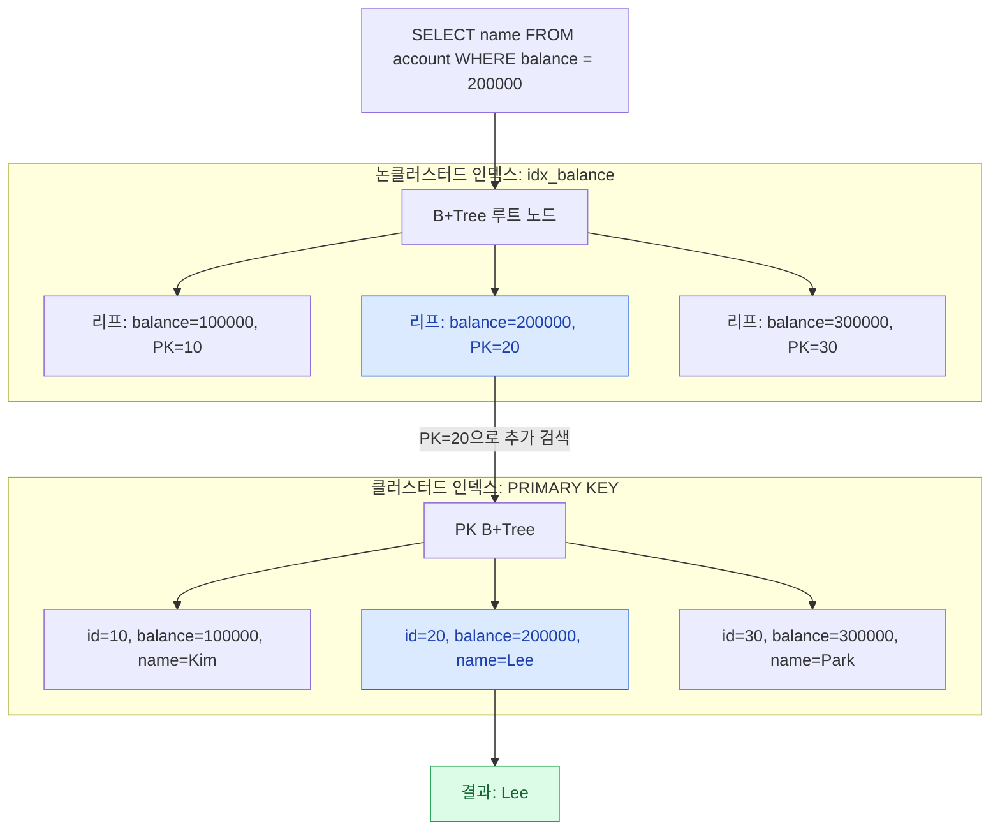

| 범주 | 문제 번호 |
|---|---|
| DB·트랜잭션 | 2, 3, 4, 5, 6, 7, 22 |
| Kafka·메시징·분산 데이터 처리 | 8, 9, 10, 11, 12, 23, 28 |
| 시스템 성능·처리량·가용성 | 13, 14, 15, 16, 26, 27 |
| 동시성·멱등성·캐시 | 1, 17, 20 |
| 네트워크·실시간 통신 | 18, 19, 24 |
| Java·알고리즘·자료구조 | 21, 29, 30 |
| 운영체제·컨테이너 | 25 |

<br>
<br>

#### DB·트랜잭션  

문제 단위로 설명하기 보단, 키워드 중심으로 이해한 방향을 서술하고자 함.  

**갱신 손실(Lost Update)**  
영어 Lost로 단어를 근거로 실제 업데이트 정보가 "손실"이 일어났다고 추론을 하였으나,  
<u>반영한 갱신의 효과가 "결과적"으로 사라짐</u>을 의미하기도 함.  
과정의 이름으로 생각하기 보단, 동시성 충돌로 발생하는 결과로 봐야 더 정확하다.  

오래된 값을 읽는 것이 주요 원인이며, `REPEATABLE READ`에서는 이를 감지하지 못한다.  
해결책으로는, 1. 조건부 Update: 아래와 같이 Where 절에 조건을 추가한다.  
```
UPDATE account
SET balance = balance - 70000
WHERE id = 1
  AND balance >= 70000;
```
다른 2.번째로는 `Select .. for Update`를 사용하여, 먼저 Select 순간에 잠금 다음 수행한다.  
마지막 3.번째로는 version 같은 새 속성을 넣고, 버전별로 검사하는 것:  
```
시간    트랜잭션 A                  트랜잭션 B
────────────────────────────────────────────────
1ms     SELECT → 100,000 / v0

2ms                                 SELECT → 100,000 / v0
                                    (Read View 생성)

3ms     UPDATE WHERE version=0
        → 성공, version=1

4ms     COMMIT

5ms                                 UPDATE WHERE version=0
                                    → 실제 최신 행은 version=1
                                    → WHERE 조건 불일치
                                    → 변경 행 0개

6ms                                 SELECT → 100,000 / v0
                                    (기존 Read View 유지)
```
REPEATABLE READ의 스냅샷 유지 규칙은 일반 Select에 적용되며,  
Update는 최신 행을 기준으로 검사를 진행한다.  
<br>
<br>

SQL 구문 삽입 문제.. "원자적"으로 처리를 해야 한다.  
위에서 설명한 1.번째 => 조건부 Update를 수행하는 구문을 작성하면 된다.  
`Update .. Set .. Where ..` 구문이 있을 때, where로 먼저 검사한 다음 true 시 => Set 수행한다.  
통상 SQL 구문 하나가 트랜잭션 하나로 치나, `@Transactional`의 경우 하나로 치며, 중간 실패시  
다 롤백은 한다.  
<br>
<br>

**트랜잭션 격리수준(Isolation Level)**  
이전에 공부한 내용, 짧게 훑어보자:  
|격리 수준|핵심 특징|발생 가능 문제|
|:--|:--|:--|
|READ UNCOMMITED|가장 낮은 격리, 다른 트랜잭션이 COMMIT 안됨에도 읽을 수 있음|ALL|
|READ COMMITED|COMMIT된 변경만 읽기 가능, SELECT => 매번 새 Read View|Non-repeatable Read|
|REPEATABLE READ|트랜잭션 중에 SELECT => 기존 Read View 유지|Phantom Read?|
|SERIALIZABLE|트랜잭션이 사실상 순차 수행되는 것|ALL NOT|

MVCC(Multi-Version Concurrency Control): 락 사용 안하고 일관된 읽기 보장.  
HOW? => 스냅샷 읽기..를 통해 시작한 시점을 스냅하여 그것만 읽는다.  
<br>
<br>

**MySQL(InnoDB)의 락 종류 훑어보기**  
MVCC는 `SELECT`에 한정해서 적용됨. 락은 보통 `UPDATE`, `DELETE`, `INSERT` 등  
상태 변화가 있는 경우에 적용.  

비관적/낙관적 락은 "동시성 충돌"을 어떻게 제어하냐? 가 분류 기준이다.  
반면, 레코드/갭/넥스트 키 락은 DB의 "어떤 범위"를 잠그냐는.. 비교적 공간? 위주의 분류 기준이다.  
이 공간은 "인덱스"를 기준으로 삼는다.  

레코드 락 => `Where id=20`같이, 해당 인덱스인 "행"을 잠근다.. 주로 UPDATE    
갭 락 => 테이블에 id가 10, 20이 있다고 쳐보자. 그 사이인 11~19번 "잠재 후보"가 INSERT 막힘  
넥스트 키 락 => 레코드 락 + 직전 갭 락: 직전은 바로 앞 `id=20`을 의미: 10, 20, 그 사이 후보들  

넥스트 키 락은 REPEATABLE READ에서 기본 적용된다.  
갭 락이 대부분 Phantom Read를 막는 역할을 한다.  
<br>

문제점: 만약 <u>인덱스가 없는</u> 컬럼을 기준으로 한다면? 예시:  
```
UPDATE orders SET ...
WHERE memo = " "
```
여기서 memo는 인덱스가 없는 속성이라 쳐보자. 이럴 경우: 사실상 테이블 전체를 잠금다.  
<br>
<br>

좀 무식?할 수 있으나,  
복합 키 인덱스 조건에서 "등치 조건 칼럼"은 앞에, "범위 · 정렬 칼럼"은 뒤에 놓는게 보통이다.  
MySQL InnoDB 기준 PK를 기정하면 반드시 인덱스가 생성된다.  
<br>
<br>

**인덱스(Index) 종류 알아보기**  
먼저, "클러스터/논 클러스터 인덱스"와 커버링 인덱스는 서로 다른 분류 기준이다.  
커버링 인덱스: 모든 칼럼을 인덱스 만으로 조회 가능 => 전부 커버?하고 있다.. 쿼리 처리 방식    

클러스터/논 클러스터는 데이터의 저장 구조를 기준으로 분류한다.  
다음 아래 예시를 기준으로 논 클러스터 => 클러스터로 가는 흐름을 살펴보자:  


클러스터 인덱스(Clustered Index)는 실제 물리적으로 행이 배열된 것을 의미한다.  
MySQL 기준 보통 PK(Primary Key)를 기준으로 클러스터 인덱스를 적용하며, Leaf는 실제 데이터로 구성  

논 클러스터 인덱스(Non Clustered Index)는 원본을 실제 정렬하는게 아니라, 별도의 인덱스 페이지를  
만든다. 이 인덱스의 Leaf는 RID(Row Identifier) 정보가 저장. 위의 예시에서는 PK 값.  
<br>

위의 Mermaid 도식화에서는 보조 인덱스인 balance를 기준으로 검색을 한 다음,  
Leaf에서 해당 값이 어떤 PK 즉, 클러스터 인덱스의 값을 가지는지 확인, 클러스터 인덱스로 진입 함.  
논 클러스터 => 클러스터 => Leaf 노드 순으로 검색을 수행하게 된다.

무엇보다!! 논 클러스터드.와 커버링 인덱스는 배타적인 개념이 아니다.  
<br>
<br>

Java에서 `equals()`와 `compareTo()`의 차이를 비교해보자:  
먼저 Java에서는 `BigDecimal`을 unscaledValue(소수점 제거한 정수) + scale(소수점 이하 자릿수)  
로 저장한다. 실제 값은 `unscaledValue × 10^(-scale)`로 계산되어 표현됨.  

표를 예시로 보자:  
|숫자|unscaledValue|scale|실제 값|
|:--|:--|:--|:--|
|123.4|1234|1|123.4|
|1234|1234|0|1234|
|123.40|12340|2|123.40|

여기서 `equals()`는 실제 값 + scale 까지 다 비교하므로, **소수점 갯수**까지 따지게 된다.  
반대로 `compareTo()`는 실제 값만 따진다. 예시 코드는:  
```
new BigDecimal("123.4").equals(new BigDecimal("123.40"));   // false
new BigDecimal("123.4").compareTo(new BigDecimal("123.40")); // 0
```
compareTo는 a < b => -1, a == b => 0, a > b => 1 이 출력된다.  
<br>
<br>

#### Kafka·메시징·분산

이전 문제 기억난다. 카프카에서는 파티션(Partition)내에서만 순서를 보장한다고..  

그럼 `enable.idempotence=true`는 구체적으로 어떤 역할을 하는가?  
이 녀석은 Producer(프로듀서: 메시지 생성자 => Spring에서 설정)에 적용한다.  
한 마디로, "실패한 전송"을 중복 발송하는 것을 막는 역할을 하는데,  
```
시간    Producer(Java)                 Kafka Broker
────────────────────────────────────────────────────
1ms     A (PID=7, Seq=0) ────────────→ 저장 성공
                                        Offset 10: A

2ms     ACK 유실 ←─────────────────────X

3ms     A (PID=7, Seq=0) 재전송 ──────→ 이미 처리한 번호
                                        → 중복 저장 방지

결과                                    Offset 10: A
                                        → 한 번만 저장
```

*왜 프로듀서에 설정을 했는데, 얘는 재전송 하고 Kafka Broker(별도 카프카 서버)가 식별해서 막나?*  

프로듀서 측에서 동일한 메시지 전송 시 동일한 PID와 Seq 번호를 사용하도록 설정.  
프로듀서는 ACK를 받지 못했을 경우(Broker 도착 x, 혹은 도착했으나 ACK만 유실) => 재전송 시행.  
브로커는 자체적으로 PID + seq를 기준으로 식별해서 중복 메시지 저장 방지함.  
<br>

덧붙이기 지식:  
**ACK(Acknowledgment)**: 브로커가 프로듀서에 보내는 "수신 확인" 응답.  
**PID(Producer ID)**: 카프카가 프로듀서를 식별하기 위해 부여한 "고유 식별 번호".  
**Seq(Sequence Number)**: 프로듀서가 파티션별로 메시지 순서를 붙이는 "순서 번호".  

=> 메시지 내용이 완전히 같더라도 PID, Seq가 다르면 카프카에선 별개의 메시지로 취급된다.  
<br>
<br>

카프카의 **메시지 전달 보장 수준(Message Delivery Semantics)**  
이 녀석은 Kafka => Consumer 사이에서 적용된다. 이름만으로 바로 파악하기 어려운데(복습했지만)..  

At-most-once: 최대 한 번 => 중복 피하지만 유실 가능: 오프셋 처리 후 커밋 
At-least-once: 최소 한 번 => 유실은 방지되지만 중복 가능: 커밋 후 오프셋 적용  
Exactly-once: 정확히 한 번 => 중복과 유실 모두 방지: .. 추후 학습 ..  

여기서 말하는 커밋?  
카프카 내부에서 오프셋 적용하려면 컨슈머에서 요청이 와야만 한다.  
다만, DB에 반영 기준을 "커밋" 기준으로 삼아 전-후를 기준으로 보장 수준을 나눈다.  
```
시간    Consumer(Java)                 Kafka Broker
───────────────────────────────────────────────────
1ms     메시지 A 읽음 (Offset 10)

2ms     Offset 11 커밋 요청 ──────────→ 기록 성공

3ms     DB에 메시지 A 반영 시도

4ms     💥 Consumer 프로세스 사망
        → 실제 처리는 완료되지 않음

5ms     Consumer 재시작
        Offset 11부터 읽기 ←───────────
        → 메시지 A 건너뜀
```
<br>
<br>

다음은 카프카와 프토듀서(Producer)의 DB의 불일치를 해결하기 위한 "설계 패턴"이다.  
이전에 복습했다.. 이 패턴은: **Transcational Outbox**  
```
주문 서비스 (Producer)
        │
        ▼
    MySQL DB
    ├─ orders 테이블
    │    → 실제 주문 정보 저장
    │
    └─ outbox 테이블
         → Kafka에 발행할 이벤트 기록
        │
        ▼
  별도 발행 프로세스
        │
        ▼
   Kafka Broker
        │
        ▼
  알림 서비스 (Consumer)
```
보통 At-least-once 방식으로 프로듀서에서 보낸다. Consumer는 별도의 "멱등성"이 필요.  

이 Outbox가 없는 경우: Producer DB저장 혹은 메시지 발행 둘 중 하나만 수행되는 문제 발생 가능.  
Outbox(발송 "대기 함")으로, 중간에 프로세스 사망 시 메시지 발송의 "근거"로 활용 가능.  
<br>

**Relay(릴레이)**: Transcational Outbox에서 DB 저장된 이벤트를 가져오는 "별도" 작업자  
별도 작업자라고 하면? => Producer는 Outbox에 넣기만 하며, 릴레이는 꺼내서 카프카에 보내기만 함.  

Relay가 그냥 무식?하게 자동으로 Outbox를 읽고 처리하는게 아닌, 각 방식이 따로 있다. 먼저,  
1. Polling - 주기적으로 DB를 확인: 이전에 읽었던 부분 별도 확인/기록 필요.  
2. CDC(Change Data Capture) - 변경 로그(Change Log: MySQL에서 자체적 관리)를 확인   

여기서 확인하는 변경로그는 Outbox 쪽 변경기록을 확인한다는 것. 예시:
```
MySQL Binlog

위치          테이블         변경 종류        변경 내용
─────────────────────────────────────────────────────────
Position 120  orders         INSERT           order_id=100
Position 121  outbox         INSERT           event_id=501
Position 122  Transaction    COMMIT           트랜잭션 확정
```
여기서, <u>outbox 테이블의 INSERT</u>만 골라내서 kafka에 보낸다.  
다만, CDC에서는 처리 위치(Offset) 또한 관리하고 있으므로, 별도로 기록할 필요가 없음.  
<br>
<br>